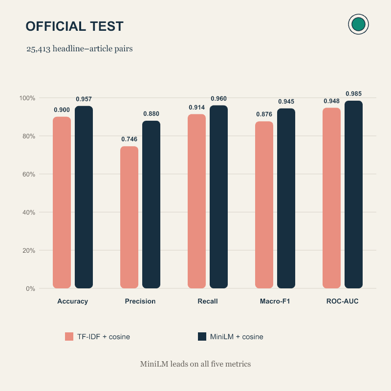
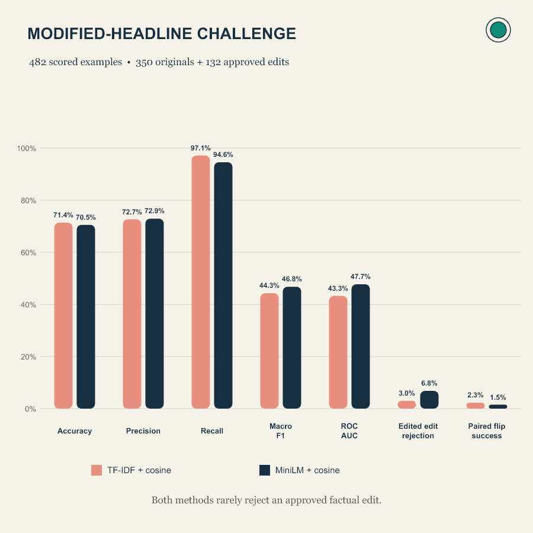

# MTech AIML Project 17: Headline–Article Consistency

**Assignment 14**  
**Group 17**  
- Anurag Rai — MT/AI/10016/26
- Ankit Singh — MT/AI/10022/26

## Project overview

This project compares two methods for deciding whether a news headline is semantically consistent with its corresponding article:

- **TF-IDF + cosine similarity** — traditional text-similarity baseline
- **Sentence embeddings + cosine similarity** — pretrained `sentence-transformers/all-MiniLM-L6-v2`

A manually reviewed modified-headline challenge tests whether the methods detect subtle factual changes. MiniLM is used as a frozen encoder; it is not fine-tuned.

## Repository structure

```text
MTech-AIML-Project_17_Headline_Article_Consistency/
├── README.md
├── requirements.txt
├── data/
│   ├── README.md
│   └── sample_data.csv
├── figures/
│   ├── modified_headline_challenge.png
│   └── official_test_results.png
├── notebooks/
│   └── experiment.ipynb
├── src/
│   ├── preprocessing.py
│   ├── model.py
│   └── evaluation.py
├── results/
│   ├── results.csv
│   └── comparison_table.csv
└── presentation/
    └── 17_Headline_Article_Consistency.pptx
```

Local datasets, fitted artifacts, and review files are excluded from Git by `.gitignore`.

## Dataset and labels

The dataset consists of FNC-1 headline–article pairs. Stance labels are mapped to the binary consistency task:

| FNC-1 stance | Project label |
|---|---|
| `agree`, `discuss` | `consistent` (1) |
| `disagree`, `unrelated` | `inconsistent` (0) |

`data/sample_data.csv` contains synthetic examples to show the expected input format; it is not used for training or evaluation. The full cleaned source files are not included. The notebook currently expects `train_labeled_clean.csv` and `official_test_labeled_clean.csv` at `B:\MTech\Codes\SEM 1\MAI\ASS\Dataset\data\processed`. If you clone the repository elsewhere, update `source_dir` in the data-splitting section of `notebooks/experiment.ipynb`.

The experiment uses a fit set of **31,957** pairs, a validation set of **7,670** pairs, and the preserved official test set of **25,413** pairs. Article groups are separated using `body_id`, with overlap checks between partitions. The challenge started with 350 original headlines and 150 proposed numeric edits. After manual review, 132 edits were approved and 18 rejected; the scored challenge contains **482 examples** (350 originals and 132 approved edits).

## Methodology

### TF-IDF + cosine similarity

Word unigrams and bigrams are converted to TF-IDF vectors. The vectorizer is fitted on the fit partition only. Cosine similarity between each headline and its article text is used as the score.

### Sentence embeddings + cosine similarity

The pretrained `all-MiniLM-L6-v2` encoder produces normalized embeddings for the headline and article text. Cosine similarity between the paired embeddings is the score. The encoder is frozen and uses a 128-token input limit.

### Threshold and metrics

Each model’s threshold is selected on validation data by maximizing Macro-F1, with consistent-class F1 as a tie-breaker. The selected thresholds are **0.0308** for TF-IDF and **0.4118** for MiniLM. Scores at or above the threshold predict `consistent`; lower scores predict `inconsistent`. Thresholds are fixed before official-test evaluation. ROC-AUC is calculated from continuous scores.

The required evaluation metrics are Accuracy, Precision, Recall, Macro-F1, and ROC-AUC. Precision and Recall treat `consistent` as the positive class. The modified-headline challenge also reports edit rejection rate and paired original/edit flip success.

## Official test results

| Method | Accuracy | Precision | Recall | Macro-F1 | ROC-AUC |
|---|---:|---:|---:|---:|---:|
| TF-IDF + cosine | 0.9004 | 0.7457 | 0.9144 | 0.8762 | 0.9477 |
| MiniLM embeddings + cosine | **0.9571** | **0.8797** | **0.9601** | **0.9445** | **0.9848** |



MiniLM scored higher on all five official-test metrics.

## Modified-headline challenge results

| Metric | TF-IDF + cosine | MiniLM + cosine |
|---|---:|---:|
| Accuracy | 71.37% | 70.54% |
| Precision | 72.65% | 72.91% |
| Recall | 97.14% | 94.57% |
| Macro-F1 | 44.30% | 46.79% |
| ROC-AUC | 43.27% | 47.73% |
| Edited-headline rejection rate | 3.03% | 6.82% |
| Paired original/edit flip success | 2.27% | 1.52% |



Both methods rarely rejected an approved factual edit. The challenge results show that strong official-test performance does not guarantee sensitivity to subtle factual changes.

## Run the experiment

1. Use Python 3.10 or later (developed with Python 3.12).
2. Install dependencies from the repository root: `python -m pip install -r requirements.txt`.
3. Open `notebooks/experiment.ipynb` and confirm the project and source-data paths in its setup cells.
4. Run the data-splitting section, then the model-training and official-test evaluation section.
5. Confirm that the manually reviewed challenge file is available at `data/challenge_headline_review_completed.csv`. For a fresh clone, provide the reviewed CSV there; it is excluded from Git because it contains news text.
6. Run the modified-headline challenge section after the vectorizer, validation thresholds, and review file are ready.

The first MiniLM run downloads the pretrained checkpoint from Hugging Face unless it is already cached. The notebook creates local split data and model artifacts as it runs.

## Limitations

- The challenge focuses on manually reviewed numeric edits and does not cover every type of misleading headline.
- Challenge articles are held out by article group from fitting and validation, but come from FNC-1’s training-side data. This is not a test on an independent news source.
- Cosine similarity measures lexical or semantic relatedness; it does not directly verify factual entailment.
- Check the dataset license before redistributing any source data, review file, or row-level prediction output.
